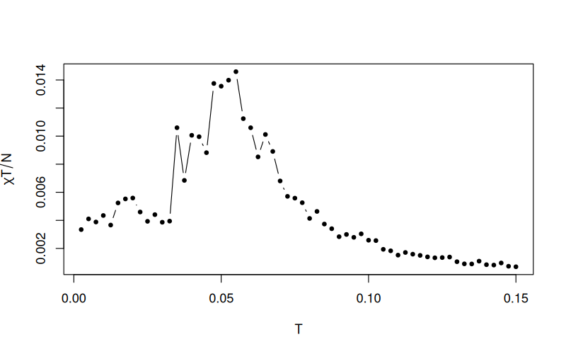
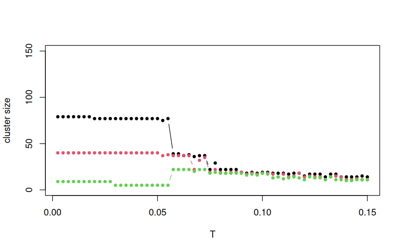

# potts

Rust implementation of Superparamagnetic Clustering (SPC), based on:

> Blatt, M., Wiseman, S., & Domany, E. (1997). *Data Clustering Using a Model of a Granular Magnet.* Neural Computation 9(8), 1805–1842. Preprint: [cond-mat/9702072](https://arxiv.org/abs/cond-mat/9702072)

SPC treats each data point as a Potts spin and couples neighbouring points with a strength that decays with distance. It then simulates the system with Swendsen–Wang Monte Carlo while heating it through a range of temperatures. Points in dense regions keep their spins aligned at higher temperatures than the weak links between regions, so clusters are the groups of points whose spins stay correlated. The susceptibility χ marks the temperatures at which clusters form and break up.

## crates

- `potts-core` — Potts model dynamics: Swendsen–Wang Monte Carlo, heating through a temperature grid, the susceptibility of eq. (6) and cluster extraction (§4.3.2). Input: a weighted graph.
- `potts-graph` — builds that graph from Euclidean point data: mutual k-nearest neighbours (`mutual_knn_graph`) with the coupling of eq. (9), which is also available on its own (`interaction_strength`) for neighbour graphs built elsewhere.

## examples

Both examples write tab-separated output to stdout and a summary to stderr. Runs are deterministic (fixed seed) and take under a second with `--release`.

### buckyball

```sh
cargo run --release --example buckyball > buckyball.tsv
```

The 60 vertices of a C60 buckyball on the unit sphere, with mutual 5-nearest neighbours (150 edges), q = 20 and 30 temperatures from 0.01 to 0.2. It's a check on a nearly uniform graph. χ is zero in the ordered phase and peaks sharply at T ≈ 0.09, close to the eq. (10) estimate of 0.087. Above that the cluster breaks up. Columns: temp, susceptibility, n_clusters.

### iris

```sh
cargo run --release --example iris > iris_spc.tsv
```

Reproduces §5.4 of the paper on Fisher's Iris data: 150 flowers with 4 measurements in cm, mutual 5-nearest neighbours, q = 20, M = 1000 sweeps and 60 temperatures from 0.0025 to 0.15. Columns: temp, susceptibility, point, species, label (one row per temperature and point).

The measurements are recorded to 0.1 cm, so many distances tie. The example counts every point tied with the 5th nearest as a neighbour. With ties broken arbitrarily, Setosa splits into several components (22, 18, …) and can't form the paper's cluster of 40. This tie rule is local to the example.

To plot the output in R:

```r
source("potts-graph/examples/plot_spc.R")
out <- read.delim("iris_spc.tsv")
plot_susceptibility(out)
plot_clusters(out, n_clusters = 3)
```



*Susceptibility density χT/N against temperature (compare Fig. 7a).*



*Largest (black), second (red) and third (green) cluster at each temperature (compare Fig. 7b).*

| | paper | potts |
|---|---|---|
| first stage | 80 + 40 (Setosa) | 79 + 40 (Setosa) |
| second stage | 45 / 40 / 38 (Versicolor / Setosa / Virginica) | at T ≈ 0.055, ~37 Versicolor split off; Virginica breaks into two pieces (~22 and ~16) |
| peak χT/N | ~0.2 | ~0.014 |

**Inconsistencies in the paper.** Two things in §5.4 don't fit together:

- *Temperature scale.* The text gives transitions at T ≈ 0.1, 0.6 and 0.8, but Fig. 7's axis runs from 0 to 0.10. Eq. (10) gives 0.083. The example follows the figure.
- *Connectivity.* §4.1.2 says K is chosen so that the graph is connected, but mutual k-nearest neighbours don't link Setosa to the other species for any K below 50. The paper's 80/40 split matches this disconnected graph. Its χT/N of ~0.2, however, is what a connected graph with an ordered low-temperature phase gives: the buckyball peaks at ~0.1, while the Iris graph reaches only ~0.014. Adding a minimal spanning tree connects the graph, but the edge to Setosa is so weak (J ≈ 2×10⁻⁷) that it never forms a bond. χ stays the same, and the clusters move further from the paper (100/50). We didn't find a graph that matches both the cluster sizes and χ.

## implementation choices

Where the paper is silent or loose, `potts`:

- heats from all spins aligned (§3 allows sᵢ = 1) and carries the spins from one temperature to the next, so no sweeps are discarded (§3);
- measures χ with eq. (6) on the spin configuration after each sweep (§4.2, step 6);
- uses a counter-based random number generator, so a run is reproducible from its seed.

## license

MIT

## acknowledgement

Developed with the assistance of [Claude Code](https://claude.com/claude-code), Anthropic's AI coding tool.
